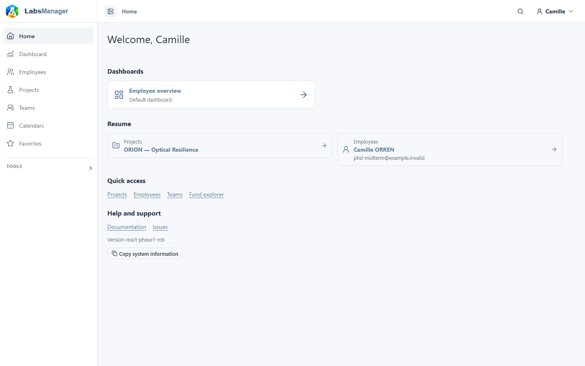

# LabsManager

Find people, projects and the information you need for laboratory work.

[Get started](user-guide/getting-started/index.md){ .md-button .md-button--primary }
[Browse the User Guide](user-guide/index.md){ .md-button }
[Find information](user-guide/finding-information/search.md){ .md-button }

## Explore the guide

[**People** Find and view a person](user-guide/people/view-person.md)

[**Projects** Open a project and explore its sections](user-guide/projects/view-project.md)

[**Finding information** Search across LabsManager or narrow a list](user-guide/finding-information/search.md)

[**Daily work** Use navigation and recognise available actions](user-guide/getting-started/interface.md)

## At a glance

The home screen gives you a starting point for navigation, dashboards and quick access to areas available to your account.

<figure class="lm-screenshot" markdown>

<figcaption>The home screen shows the areas available to your account.</figcaption>
</figure>

*Guide for LabsManager v1.0. [Earlier documentation](other/legacy-overview.md) remains available while this guide grows.*
