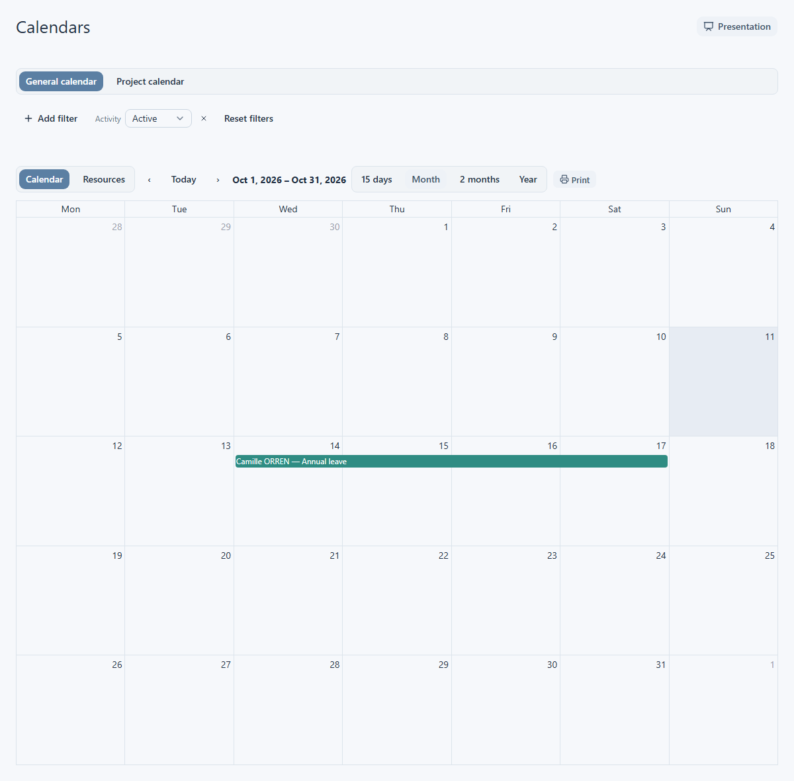

# Use the calendars

Choose **Calendars** in the main navigation to open the calendars across the records you can see. The page has **General calendar** and **Project calendar** tabs. Switch tabs to change the kind of information shown; the filters and date controls change with the tab.

## Read the General calendar

**General calendar** opens first. Its **Calendar** mode shows visible employee leave across the selected period. Other calendar events may appear when plugins are enabled. Choose **Resources** to arrange the same calendar by employee. In Resources, use the resource selector to show employees with events in the visible period, all visible employees, or employees with an event today. The last choice checks today's events even if you are looking at another period.

Use the previous and next controls to move through time, or **Today** to return to the current period. Choose **15 days**, **Month**, **2 months**, or **Year** to change the span. Check the displayed dates after switching the span.

Use the filters above the calendar to narrow employees by activity, current status, team, a specific employee, or leave type. If a plugin provides calendar filters, its controls appear separately below the standard filters. The available events and filters depend on your access and installed plugins. An empty period means there are no visible items for the current selection.

<figure class="lm-screenshot" markdown>

</figure>

Select a leave event to open its details, including its dates and the employee link when available. This cross-employee calendar is for reading: it does not offer leave creation, dragging, resizing, or editing. Plugin events can provide display or tooltip information without opening a leave detail sheet.

The **Print** action prepares a printable view of the current period and filters. **Presentation** hides the filter controls and offers an exit button; it does not change the underlying data. There is no export action on this page.

## Read the Project calendar tab

**Project calendar** on this page is a cross-project planning timeline. It shows visible projects, their tasks and milestones, and any project calendar events supplied by plugins. Use the previous and next controls or **Current** to move the window. Choose **6**, **12**, **24**, **60**, or **120 months** to change its length. Filters can narrow active or overdue projects, team, institution, funder, a specific project, or milestone status. Plugin filters may also appear here.

Select a project to open its record, or select a task or milestone to read its detail sheet. The tab also has **Print** for its current timeline. It is a reading view; editing controls are not exposed here. What appears depends on the projects and planning items you can view.

For the calendar and events of one project, use the [project calendar](../projects/project-calendar.md). For its tasks and milestones, see [Tasks and milestones](../projects/tasks-and-milestones.md).
