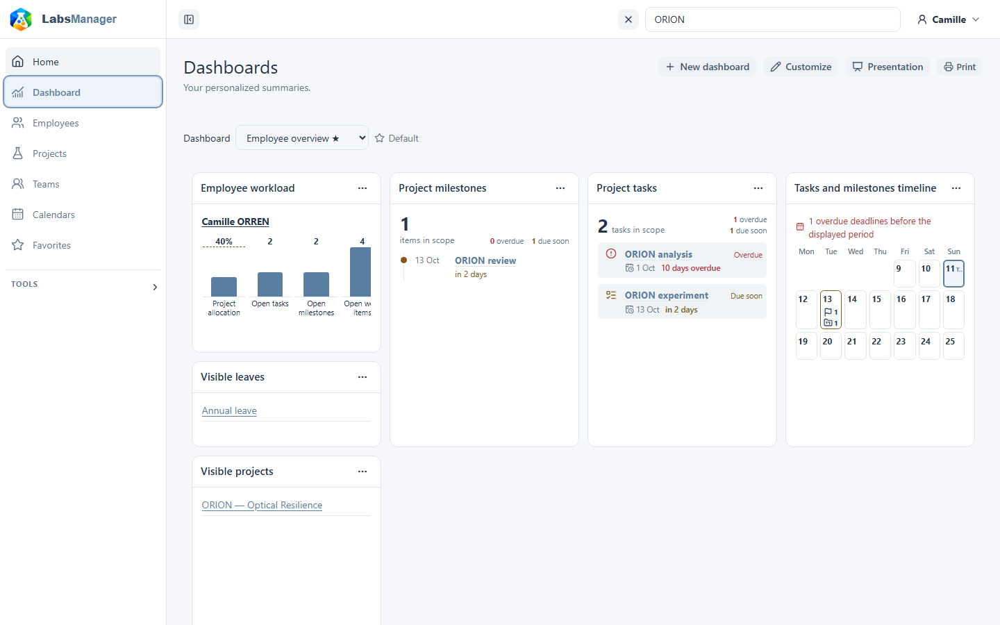
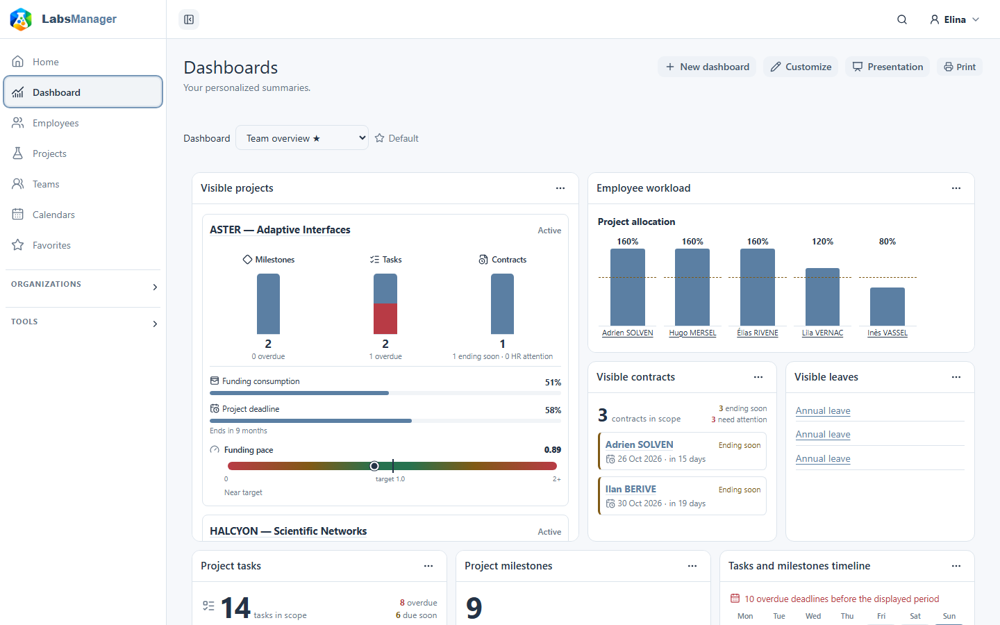
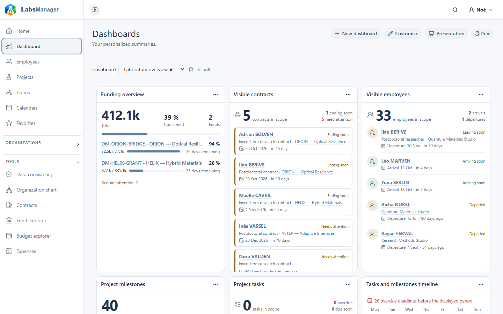

# Utiliser votre tableau de bord

Votre tableau de bord regroupe les projets, les activités et les échéances visibles pour votre compte. Choisissez **Dashboard** dans la navigation principale pour l’ouvrir. Les comptes de démonstration disposent déjà d’un tableau de bord initial : ils accèdent directement à une disposition renseignée.

## Lire et changer de tableau de bord

Vérifiez le nom du tableau de bord en haut de la page. Si vous en avez plusieurs, utilisez le sélecteur **Dashboard** pour passer de l’un à l’autre. Le tableau de bord marqué **Default** s’ouvre en premier et apparaît également comme lien principal vers votre tableau de bord sur Home. Les widgets peuvent afficher un nombre, une courte liste, des alertes ou une progression. Lorsqu’un lien est disponible, sélectionnez-le pour ouvrir la fiche correspondante ; son contenu dépend de vos droits.

Le jeu de données de démonstration prépare ces vues initiales :

| Vue initiale | Informations regroupées |
| --- | --- |
| **Employee overview** | Projets auxquels vous participez, jalons et tâches à venir, et prochains congés. |
| **Team overview** | Projets et échéances suivis, membres de l’équipe et congés, financements visibles, et contrats nécessitant une attention. |
| **Laboratory overview** | Projets visibles et éléments en retard, prochains jalons, financements dont ceux arrivant bientôt à échéance, contrats et mouvements de collaborateurs. |

Les captures ci-dessous montrent les trois tableaux de bord personnels par défaut du jeu de données de démonstration.

### Employee overview

### Team overview

### Laboratory overview

Il s’agit de dispositions initiales, et non de niveaux d’accès figés. Un widget peut être vide si aucune information visible ne correspond. Un même modèle peut afficher des résultats différents selon l’utilisateur.

## Créer votre premier tableau de bord

Si votre compte n’a pas de tableau de bord personnel, la page Dashboard vous demande un nom et un **Starting template** : Employee, Leader, Lab manager ou Blank. Aucun modèle n’est présélectionné. Faites votre choix, puis sélectionnez **Create dashboard**. Blank commence sans widget ; les autres choix fournissent une disposition initiale. Vous pourrez ensuite créer un autre tableau de bord avec **New dashboard**.

## Tableaux de bord de projet et évolution des dépenses

Un projet peut aussi avoir sa propre section **Dashboard**. Sa disposition initiale comprend **Expense evolution**, un graphique des dépenses mensuelles visibles pour ce projet. Ce widget ne fait pas partie des trois tableaux de bord personnels préparés dans le jeu de démonstration. Il peut aussi être ajouté depuis le catalogue des widgets lorsqu’il est disponible. Ce graphique est une vue du tableau de bord, pas une fiche de financement distincte ni une prévision.

Continuez avec [Personnaliser votre tableau de bord](customize-your-dashboard.md) pour modifier une disposition personnelle.
