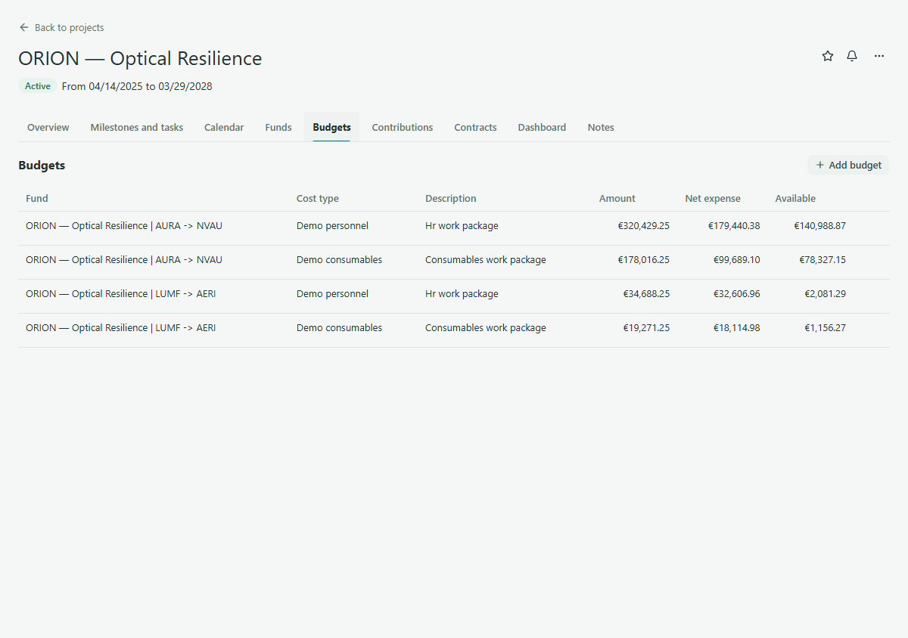
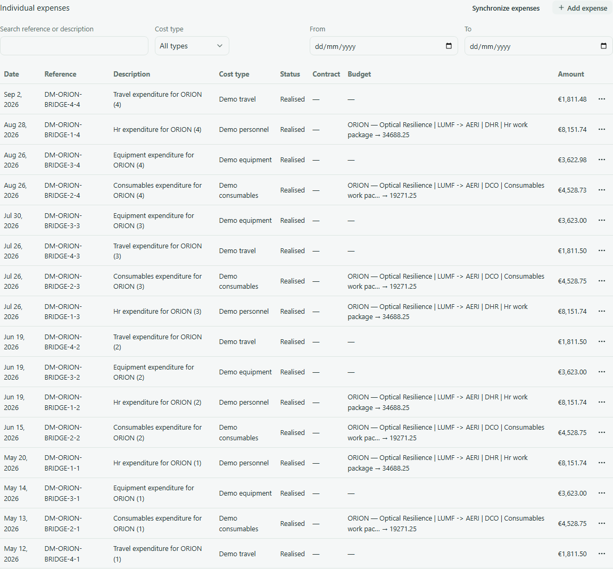

# Budgets and expenses

Project budgets describe planned allocations. Expenses record individual transactions. Both are available from the React project record when your permissions allow them.

## Read budgets on a project

Open a project and choose **Budgets**. Each row identifies its fund, cost type and description, then shows **Amount**, **Net expense** and **Available**. The ORION example has separate rows for its visible funds and cost types. Select a budget row to show expenses linked to that budget. Open its details when you need the associated employee type, contract type, employee or allocation.

<figure class="lm-screenshot" markdown>

</figure>

The **Contributions** section is separate from budgets. Its rows show fund, cost type, description, amount and start and end dates. Open a contribution to inspect its staffing and allocation details. A contribution's period and allocation do not replace a budget balance.

## Inspect expenses

After selecting a fund in **Funds**, **Individual expenses** shows the transactions for that fund. After selecting a row in **Budgets**, the expense list shows transactions for that budget. The table provides date, reference, description, cost type, status, contract, budget and amount. Use the search, cost type and date range controls to narrow the list; select a row to read its details. The `DM-ORION-BRIDGE` example shows dated transactions under several cost types.

<figure class="lm-screenshot" markdown>

</figure>

For expenses across your visible projects, choose **Tools → Expenses**. This list supports filters for cost type, dates, description, project, funder, institution, fund reference, status and expense reference. You can sort the available columns and page through results.

The controls to add, change, delete or synchronise expenses appear only when your permissions allow the action. This guide covers reading the financial information; check your local procedure before changing it.

See [View a fund](view-a-fund.md) for the funding summary or [Fund explorer](fund-explorer.md) for a cross-project view.
