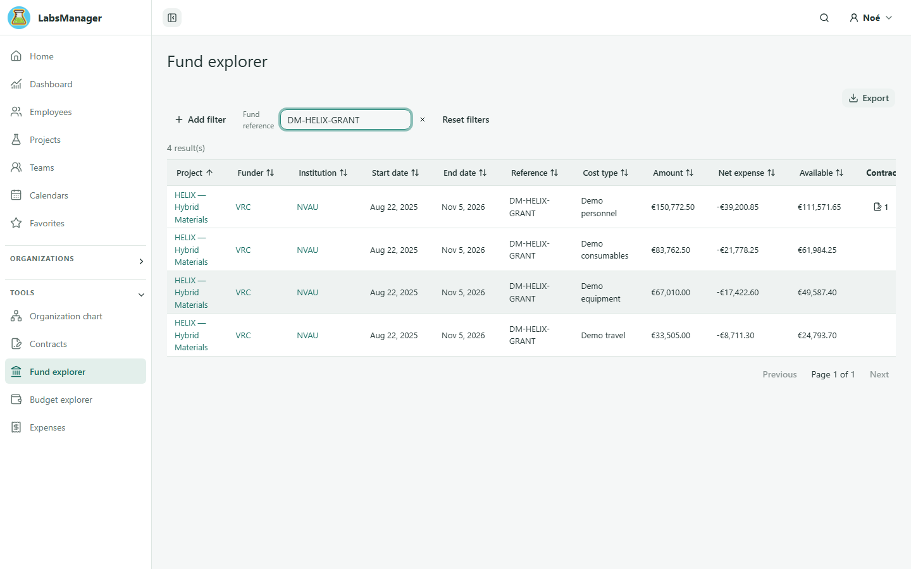

# Fund explorer

Choose **Tools → Fund explorer** to compare funding items across projects you are allowed to see. Each result is a **fund item** associated with a fund; several rows can share the same fund reference. Filtering by `DM-HELIX-GRANT` in the demonstration dataset displays four fund-item rows. This is a read-only list, not a separate fund record.

## Find and compare items

Filter by cost type, available amount, activity, project, institution, funder, fund reference or participant. The **Overdue** filter is also available. Sort a column heading to change the order; **End date** helps you review the soonest fund end dates. The list shows project, funder, institution, fund dates and reference, cost type, amount, consumed amount and available amount. Open a row for its details.

<figure class="lm-screenshot" markdown>

</figure>

A project, funder or institution name opens its record only when you have permission to view that record. To read a fund's combined summary and its expenses, open its project and select the fund in **Funds**: [View a fund](view-a-fund.md).

## Visibility

The explorer only returns fund items whose funds and projects are visible to your account. A missing result does not prove that no fund exists. Access to the tool in the navigation does not grant access to every project's financial data.
