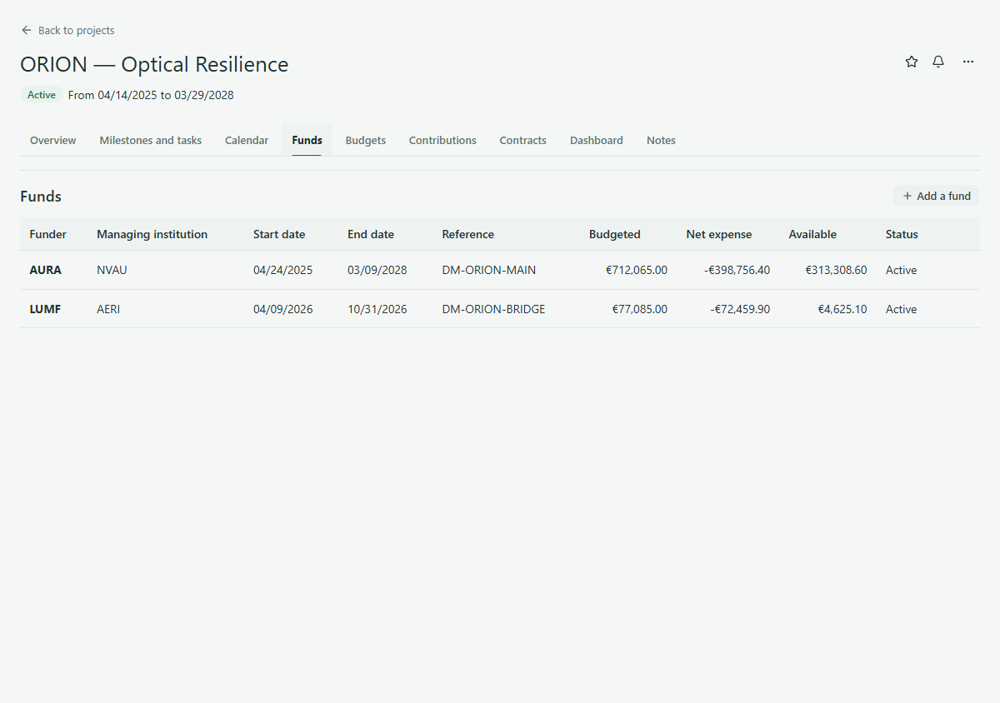
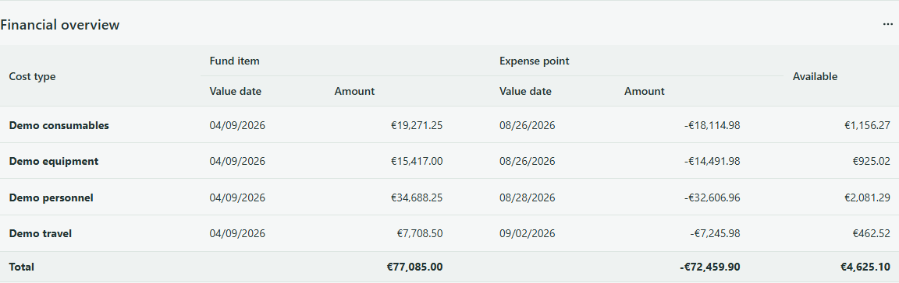

# View a fund

Use a project's **Funds** section to see its funding. The section appears when you have permission to view funding for that project. There is no separate fund record page in the React guide.

## Find the fund

Open the project, then choose **Funds**. Check the funder, managing institution, period and reference to identify the right row. The table also shows **Budgeted**, **Net expense** and **Available**, plus the fund status. For example, ORION — Optical Resilience lists `DM-ORION-BRIDGE` alongside another fund. Select the row you need to open its financial overview and individual expenses below the list.

<figure class="lm-screenshot" markdown>

</figure>

If you are looking across projects, use the [Fund explorer](fund-explorer.md) instead. Its rows represent fund items, so a fund may appear more than once.

## Read the financial overview

The **Financial overview** groups fund items and expense points by cost type. Read the total row for the displayed amount, net expense and available balance. The selected `DM-ORION-BRIDGE` view shows these totals beneath the cost-type rows. Net expense can display with a minus sign in this summary; individual transactions appear in the expenses list. Use that list to inspect the transactions behind the summary. **Available** is the balance displayed by LabsManager for the current data, not a forecast of future commitments.

<figure class="lm-screenshot" markdown>

</figure>

The fund row also shows its end date. To compare end dates across visible funding, open the Fund explorer and sort by **End date**. There is no dedicated “ending soon” view in this workflow.

## If information is missing

The **Funds** section and its actions depend on permissions. If the section is absent, ask a laboratory administrator about access to that project and its funding. If a fund is visible but has no expense rows, there may be no visible expenses for that fund; do not read the empty list as a zero balance without checking the overview.

For project budgets and individual transactions, continue with [Budgets and expenses](budgets-and-expenses.md).
