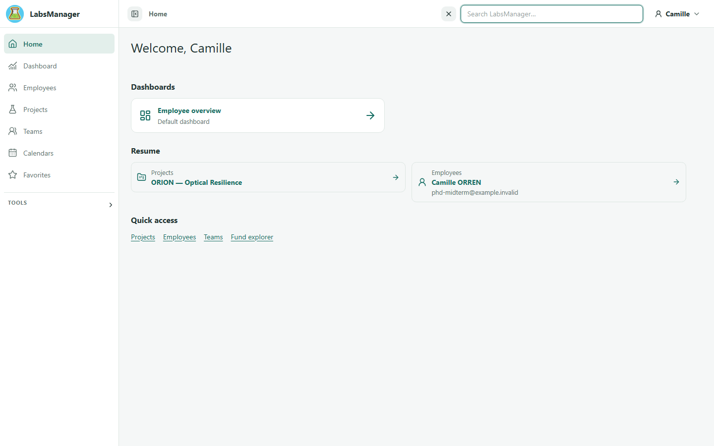
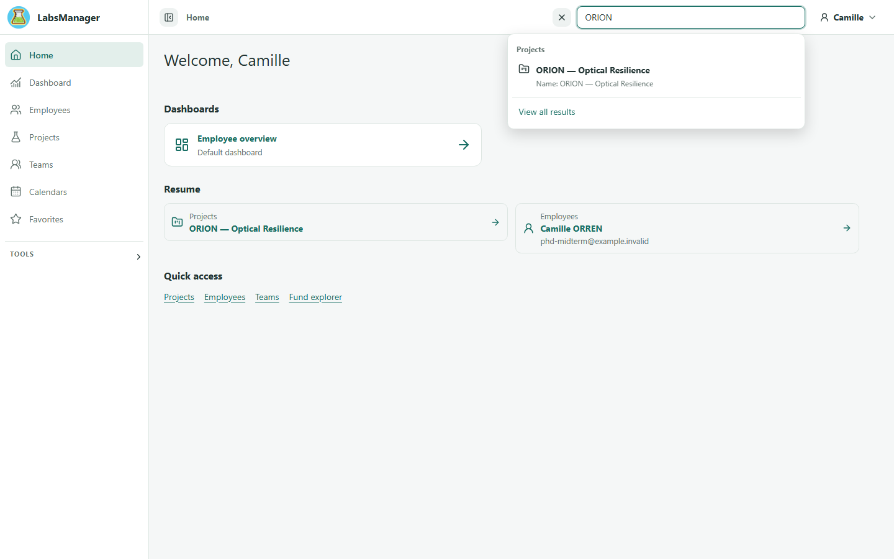

# Search and filter information

Use global search when you know a name or term but not its area. Use a list's search, filters and sorting when you already know the type of item you need.

## Search across LabsManager

1. Select the search icon in the top bar.
2. Enter a person's name, project name or funding term.
3. Review the matching results. Open the record you need, or select **View all results** for the full list.

Search shows information that your account can see. If you do not find an item, check the spelling and try a shorter term. Access restrictions can also affect results.

<figure class="lm-screenshot" markdown>

</figure>

<figure class="lm-screenshot" markdown>

<figcaption>Choose the matching result, or select **View all results** to review the full search list.</figcaption>
</figure>

## Narrow a list

1. Open the relevant area, such as people or projects.
2. Enter a term in the list search, or choose an available filter.
3. Sort the results if that helps you compare them, then open the matching row.

The filters offered depend on the list. Clear or change a filter when the expected item does not appear. Long lists may have multiple pages.

## Continue

[View a person](../people/view-person.md) or [view a project](../projects/view-project.md). For the general page layout, [understand the interface](../getting-started/interface.md).
