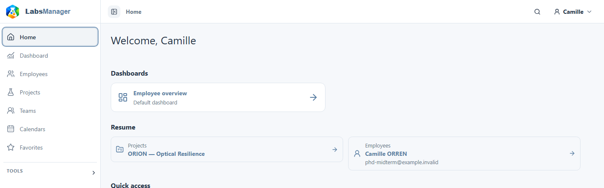

# Découvrir l’interface

Utilisez la navigation principale pour choisir une rubrique, une liste pour trouver un élément, puis sa fiche pour consulter les informations liées. Ce parcours est commun aux collaborateurs et aux projets.

## Passer d’une rubrique à l’autre

Choisissez une rubrique dans la navigation principale. Sa liste affiche les éléments auxquels vous avez accès. Ouvrez une ligne pour consulter sa fiche. Utilisez ensuite la navigation propre à la fiche pour passer d’une section à l’autre sans quitter le collaborateur ou le projet en cours.

<figure class="lm-screenshot" markdown>

<figcaption>La barre latérale ouvre les rubriques principales ; la barre supérieure donne accès à la recherche et aux commandes du compte.</figcaption>
</figure>

## Lire une fiche

Vérifiez d’abord le titre pour confirmer que vous avez ouvert le bon élément. Choisissez ensuite la section utile à votre tâche, par exemple les projets d’un collaborateur ou les participants d’un projet. Une même information liée peut apparaître dans plusieurs fiches. La présence d’un lien dans une fiche ne garantit pas à elle seule l’accès à la fiche liée.

## Reconnaître les actions disponibles

Cherchez les actions près d’une liste, du titre d’une fiche ou d’une section. Une action peut être absente ou indisponible si votre compte n’a pas les droits requis sur l’élément. Si une action nécessaire manque, renseignez-vous auprès de votre administrateur local sur vos accès.

## Continuer

[Rechercher une information](../finding-information/search.md), [consulter un collaborateur](../people/view-person.md) ou [consulter un projet](../projects/view-project.md).
