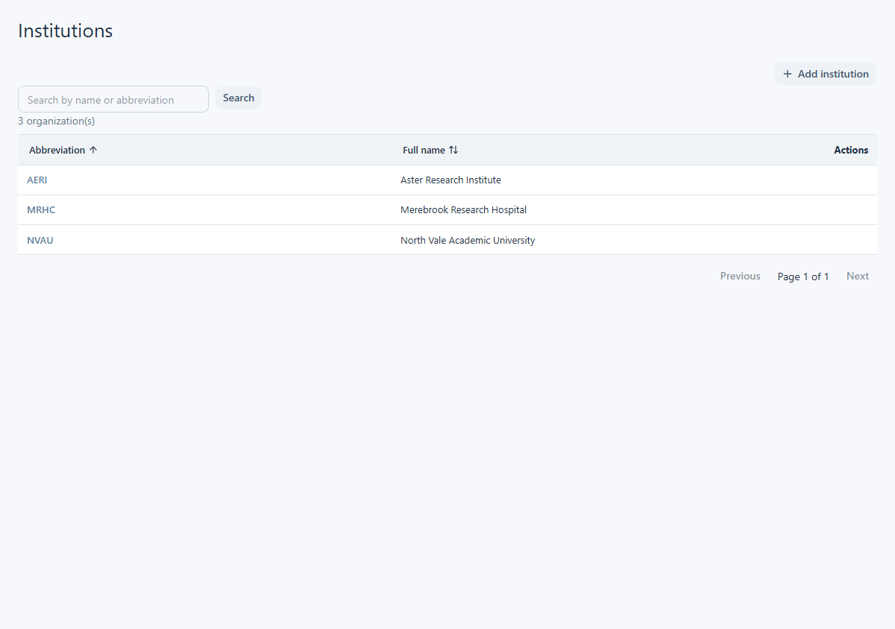
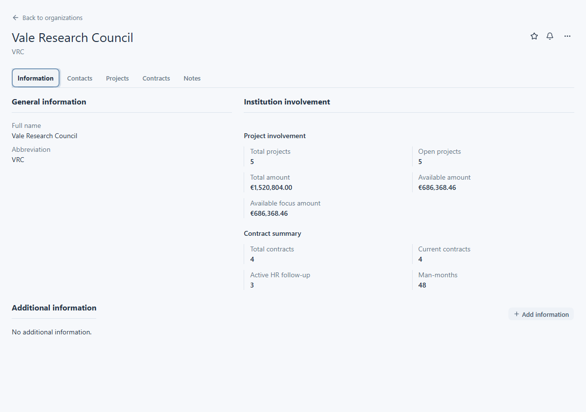

# Find and view organizations

LabsManager has two organization lists. **Institutions** are organizations recorded as institutions on funding linked to projects. **Funders** are the organizations recorded as funding sources. They use the same list and record layout, but each list contains its own type. An institution is not automatically a funder, and an organization record does not by itself grant access to its related projects or contracts.

## Find an institution or funder

Open **Organizations** in the main navigation, then choose **Institutions** or **Funders**. This navigation group appears only when your account can view organizations. Each list shows a short name and full name. Search either name, sort by either column, and use **Previous** or **Next** when there is more than one page. Select the short name or row to open a record. Its **Back** link returns to the corresponding list without the current search.

In the demonstration data, **North Vale Academic University (NVAU)** is an institution and **Vale Research Council (VRC)** is a funder. Both have funding relationships to demonstration projects; the entries you see depend on your access.

<figure class="lm-screenshot" markdown>

<figcaption>The Institutions list uses the same search and table layout as Funders.</figcaption>
</figure>

## Read the record

The **Information** tab shows the full and short names, followed by summaries of related projects and contracts. Project figures include the number of projects, open projects, total amount and available amounts; contract figures include counts and person-months. These summaries reflect only the funding, projects and contracts visible to your account. **Additional information** can show configured fields such as contact details; it may be empty. In this version, the shared summary heading says **Institution involvement** on funder records too.

<figure class="lm-screenshot" markdown>

<figcaption>The VRC funder record shows its name, Information tab and visible relationship summaries.</figcaption>
</figure>

Use **Contacts** to see a person's name and contact type. Select a contact to open its details and any additional information. An empty list means that no contact is recorded. The **Projects** and **Contracts** tabs show related records you can view. Select a project to continue in its [project record](../projects/view-project.md); contracts can open their details in the tab. The **Notes** tab contains notes when available. There is no separate Funds tab on an organization record; for the funding attached to a project, see [View a fund](../finance/view-a-fund.md).

## Actions and access

Depending on your permissions, the list may offer **Add Institution** or **Add Funder** and row actions to edit or delete. The record action menu may offer **Edit** or **Delete**. Contacts and additional information have their own add and row actions when permitted. Deleting an organization referenced by a fund is unavailable. If an action is absent, you do not have that permission in this context.

The organization list can be available while some related projects or contracts remain hidden. A blank related section does not prove that the organization has no relationships elsewhere in LabsManager.
