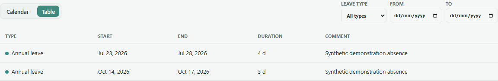

# View a person's leave

Open a person's **Leave** tab to see their recorded absences. The view can show a calendar or a table, so choose the one that best answers your question.

## Find leave in a period

1. Open the person from **Employees**, then select **Leave**.
2. Choose **Calendar** to see dates in context, or **Table** to compare leave records.
3. Move to the period you need or use the leave type and date filters to narrow the view.
4. Open a leave entry to see its details when the entry is available to you.

The table shows the leave type, start, end, duration and any comment. The calendar helps locate an absence in time. Camille ORREN has past and upcoming demonstration leave records; the requested capture uses **Table** view to show them clearly.

The **Add leave** and change controls appear only when you have permission. This guide covers finding and reading leave; instructions for changing a record will follow in a later lot.

<figure class="lm-screenshot" markdown>

</figure>

## Continue

[View projects and contracts](work-and-contracts.md) or return to the [person overview](view-person.md).
