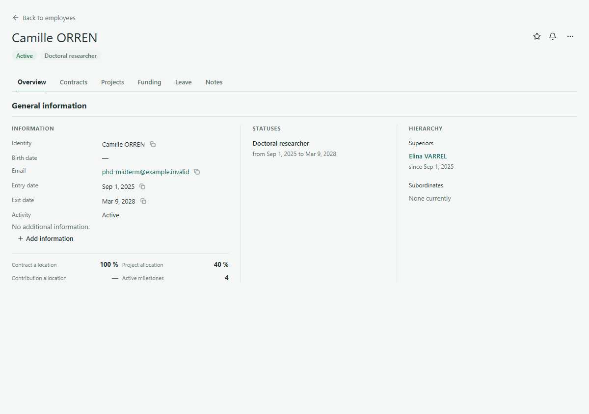

# View a person

A person's record brings together their identity, current status and links to their work. Use it to confirm that you have found the right person and to move to the information you need.

## Find the person

Open **Employees** from the main navigation, then find the person in the list. In the demonstration dataset, look for Camille ORREN. You can also use [search and filters](../finding-information/search.md). Open the matching record and check the name in its heading.

## Read the overview

The overview places basic information, statuses and hierarchy together. Check the heading and activity first; then read the section relevant to your task. The statuses area shows current and earlier positions when available, while the hierarchy area shows reporting relationships. Some information may still be loading when the page first opens.

## Check additional information

The overview may include extra information defined for your laboratory. If none is recorded, it says **No additional information.** An **Add information** action appears only when your account may add it. The Camille ORREN demonstration record currently shows the empty state.

## Move to related information

The record has sections for contracts, projects, funding, leave and notes. Choose a section to inspect its information in the context of this person. A related item shown here may still require separate access to open its own record. For the next steps, see [projects and contracts](work-and-contracts.md) or [leave](leave.md).

Actions such as editing or exporting may vary with your permissions and the person you are viewing.

<figure class="lm-screenshot" markdown>

<figcaption>The overview brings together personal details, current status and reporting relationships.</figcaption>
</figure>

## Continue

[Understand the interface](../getting-started/interface.md) or [view a project](../projects/view-project.md).
