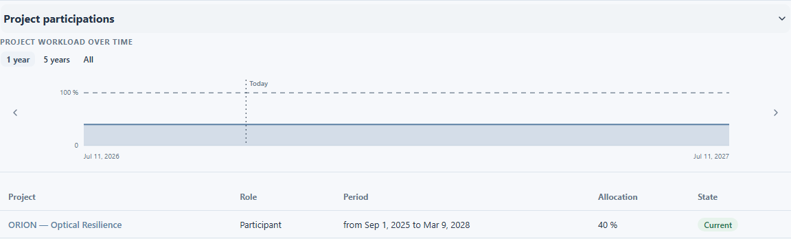
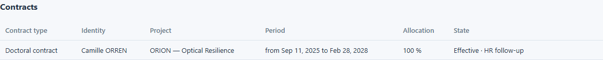

# Projets et contrats d’un collaborateur

Utilisez la fiche d’un collaborateur pour voir où il travaille et quels contrats lui sont liés. Commencez par [Consulter un collaborateur](view-person.md), puis choisissez l’onglet adapté à votre question.

## Voir les participations aux projets

1. Ouvrez l’onglet **Projects** du collaborateur.
2. Dans la vue **List**, trouvez la section **Projects**. Chaque participation indique le projet, le rôle de la personne, la période, la quotité et le statut actuel ou passé.
3. Ouvrez le nom d’un projet s’il est cliquable et si vous avez besoin de sa fiche propre.

L’onglet propose aussi une vue **Gantt** et une section des jalons. Elles aident à situer l’activité du collaborateur ; le suivi détaillé du planning est expliqué dans le guide Projet. Un nom de projet peut apparaître sans lien si vous ne pouvez pas ouvrir ce projet séparément.

Camille ORREN participe à ORION dans les données synthétiques de démonstration.

<figure class="lm-screenshot" markdown>

</figure>

## Voir les contrats

1. Ouvrez l’onglet **Contracts** du collaborateur.
2. Lisez dans la liste le type de contrat, le projet associé, la période, la quotité et le statut.
3. Sélectionnez une ligne si vous avez besoin des détails disponibles sur ce contrat.

Comparez les dates avec la période qui vous intéresse. Les libellés **Effective** et **Provisional** décrivent le statut du contrat ; ils n’indiquent pas à eux seuls si le contrat couvre la date du jour.

La liste et ses actions dépendent de vos droits de consultation et de modification. Les commandes **Add contract**, de modification et de suppression n’apparaissent que lorsqu’elles sont disponibles pour votre compte. Camille ORREN a un contrat lié à ORION dans les données de démonstration.

<figure class="lm-screenshot" markdown>

</figure>

## Continuer

[Consulter les absences](leave.md) ou revenir à l’[aperçu du collaborateur](view-person.md).
