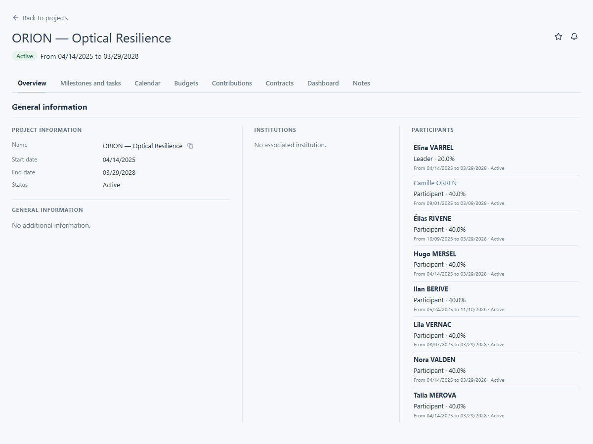

# Collaborateurs et responsabilités

Utilisez la section **Participants** de **Overview** pour voir qui participe à un projet. Cette section se trouve dans l’aperçu et non dans un onglet distinct.

## Lire les participations

1. Ouvrez le projet et restez dans **Overview**. Pour ce guide, ouvrez ORION — Optical Resilience.
2. Repérez **Participants**, puis la personne recherchée.
3. Lisez ensemble son rôle, sa quotité, ses dates de participation et son statut actif ou inactif. La quotité correspond à la part de son temps enregistrée pour ce projet ; les dates indiquent quand cette participation s’applique.

Le nom d’un collaborateur n’ouvre sa fiche que si vous y avez accès. La section peut afficher un nom sans lien. Les commandes d’ajout ou de modification des participants n’apparaissent que si votre compte possède les droits requis.

<figure class="lm-screenshot" markdown>

</figure>

## Continuer

[Lire les tâches et jalons](tasks-and-milestones.md) ou revenir à l’[aperçu du projet](view-project.md).
