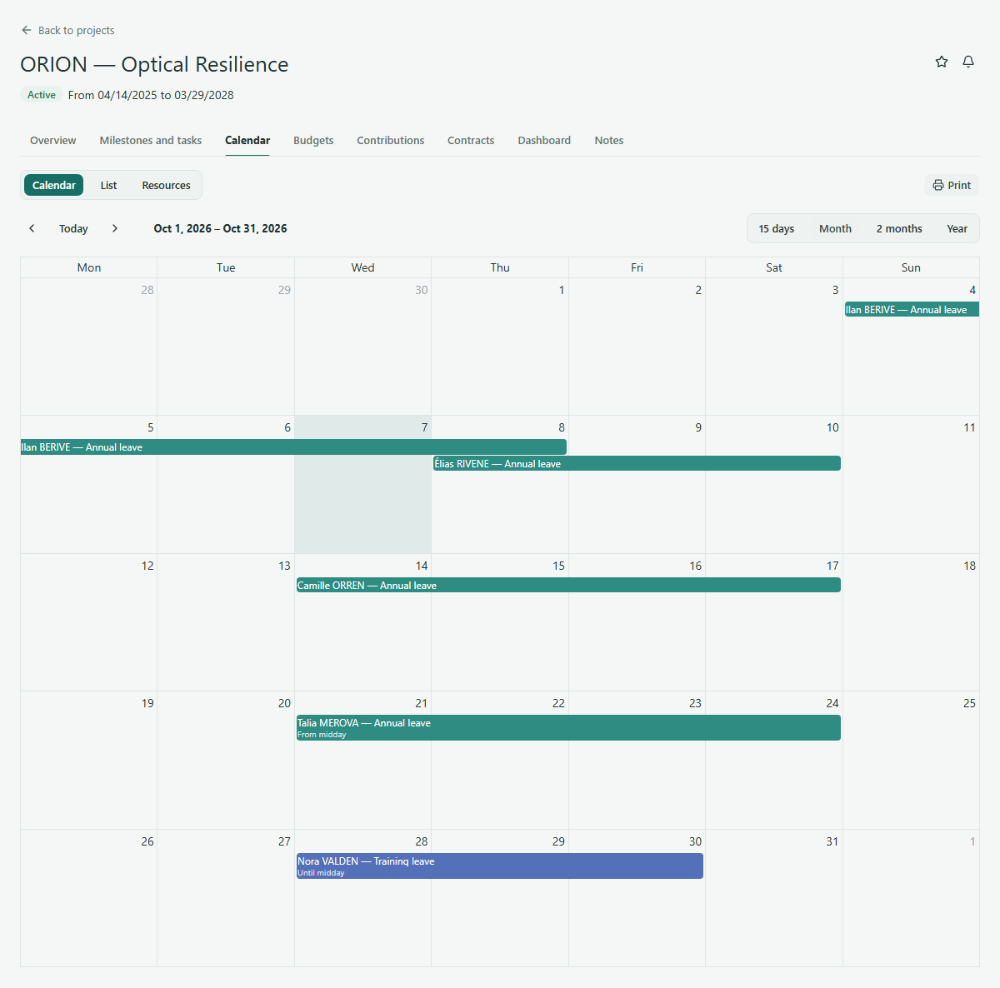

# View a project calendar

Use a project's **Calendar** to see events in the context of that project. This guide covers the **Calendar** mode in **Month** view.

## Choose a month

1. Open ORION — Optical Resilience and select **Calendar**.
2. Choose **Calendar** and **Month** if another mode or period is selected.
3. Use the previous and next controls to move through months, or **Today** to return to the current period. Check the displayed date range before reading events.
4. Use any visible filters to narrow the events. Open a visible event when you need the details available to you.

The calendar may show project-related events, including leave recorded for participants. Which events and actions you can see depends on your access and the active configuration. A month with no visible events is not evidence that the project has no work planned; tasks and milestones are read in their [own section](tasks-and-milestones.md).

<figure class="lm-screenshot" markdown>

</figure>

## Continue

[Read tasks and milestones](tasks-and-milestones.md) or return to the [project overview](view-project.md).
