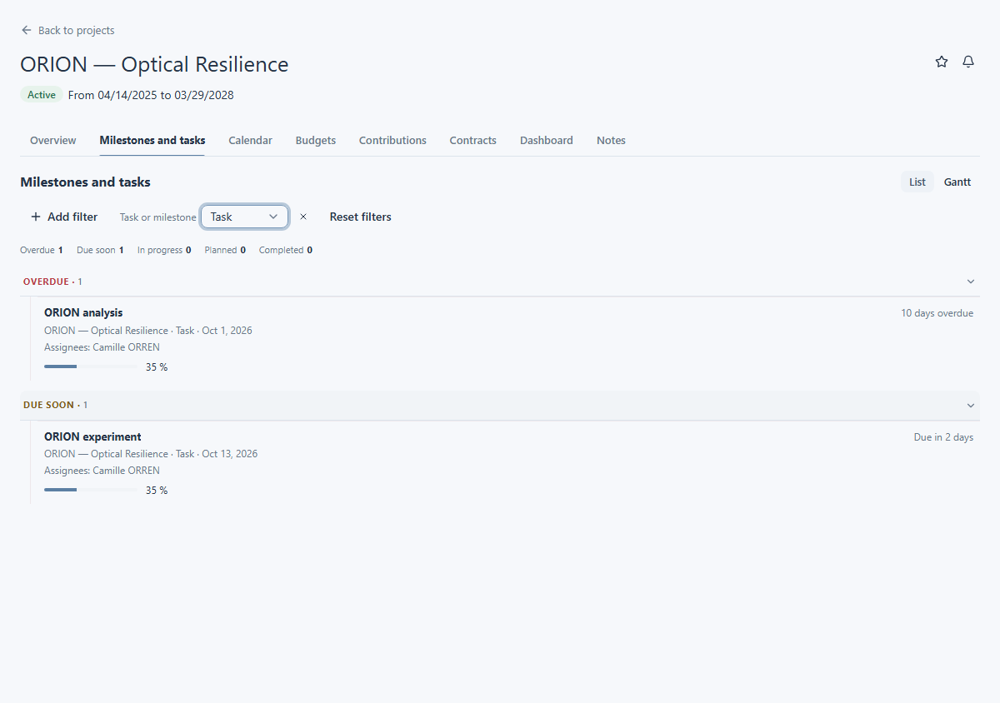
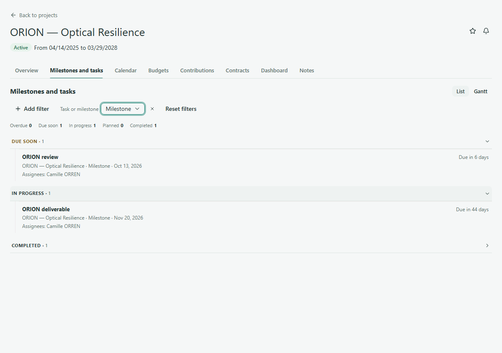

# Tâches et jalons

La section **Milestones and tasks** rassemble les travaux et les points d’étape du projet. Une tâche décrit un travail à effectuer ; un jalon marque une étape ou un résultat à atteindre. Utilisez la liste pour comparer les échéances et les personnes affectées.

## Trouver les tâches

1. Ouvrez ORION — Optical Resilience et sélectionnez **Milestones and tasks**.
2. Restez dans la vue **List** et utilisez le filtre **Task or milestone** pour afficher les tâches lorsque vous souhaitez réduire la liste.
3. Lisez le nom de chaque tâche, sa date ou son indication d’échéance, son groupe d’état et ses responsables lorsqu’ils sont indiqués. Certaines tâches affichent aussi une progression.

La liste regroupe les éléments par état, notamment **Overdue**, **Due soon**, **In progress**, **Planned** et **Completed**. Déployez un groupe pour voir ses éléments. Ouvrez un élément pour consulter les détails disponibles. L’absence de date d’échéance est signalée comme telle ; elle ne signifie pas que l’élément est terminé.

<figure class="lm-screenshot" markdown>

</figure>

## Trouver les jalons

Utilisez la même section **Milestones and tasks**. Réglez **Task or milestone** sur les jalons si vous voulez voir uniquement les points d’étape. Lisez leur nom, leur échéance, leur groupe d’état et les responsables affichés. La navigation est commune aux tâches et aux jalons ; le type de l’élément indique ce que vous consultez.

<figure class="lm-screenshot" markdown>

</figure>

La commande **Gantt** offre une vue chronologique, mais cette page traite de la lecture de la liste. Les commandes de modification et d’ajout dépendent de vos droits.

## Continuer

[Consulter le calendrier du projet](project-calendar.md) ou revenir à l’[aperçu du projet](view-project.md).
