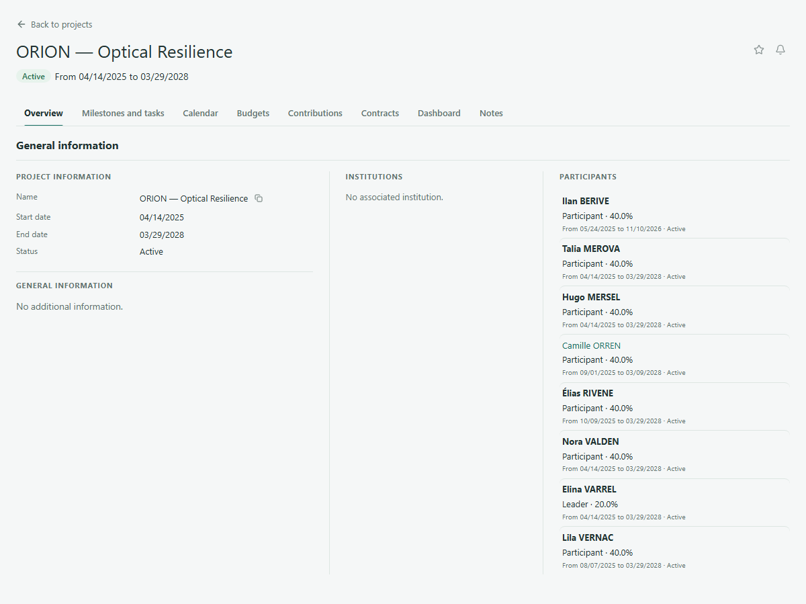

# View a project

A project record brings its status, dates and related work into one place. Open it to confirm the project before choosing a more detailed view.

## Find and open a project

Open **Projects** from the main navigation, or use [search and filters](../finding-information/search.md). Open the matching record and check its name in the heading. ORION — Optical Resilience is the demonstration project used in this guide.

## Read the overview

Check the project's status and date range in the heading. The **Overview** includes general information, associated institutions and a **Participants** section. It may also contain additional information defined for your laboratory. Use [People and responsibilities](people-and-responsibilities.md) when you need to understand who is involved.

<figure class="lm-screenshot" markdown>

</figure>

## Choose the next view

Select **Milestones and tasks** to read planned work and checkpoints, or **Calendar** to see events in a period. The project record may offer other sections and actions. What you can open or change depends on your permissions.

## Continue

[Read tasks and milestones](tasks-and-milestones.md), [view the project calendar](project-calendar.md), or [view a person](../people/view-person.md).
