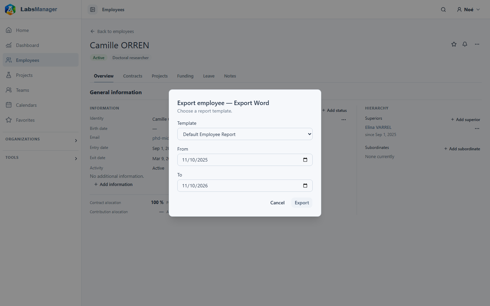
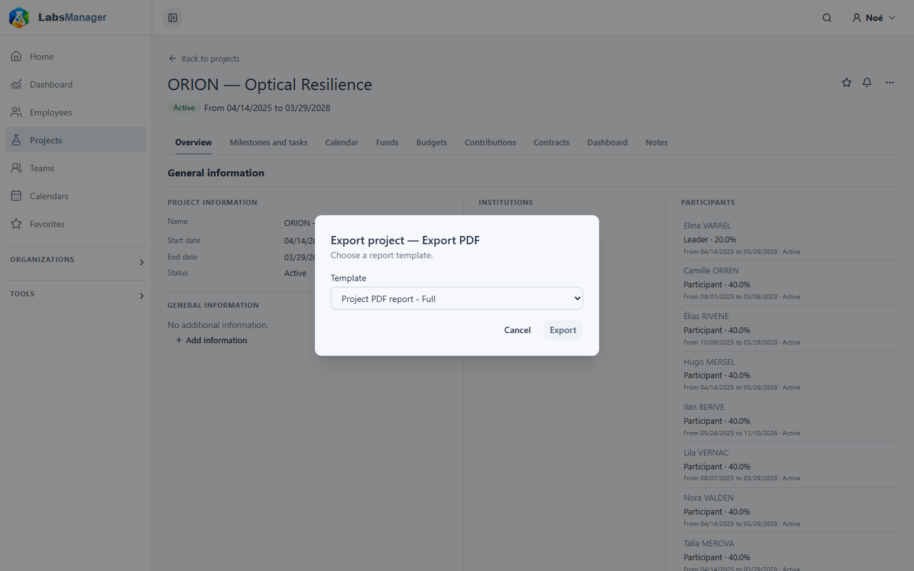

# Générer des rapports et exporter des listes

Vous pouvez télécharger un rapport sur une personne ou un projet si votre compte a accès à cette fiche et au format du rapport. L’export des listes est un autre moyen de télécharger les lignes que vous pouvez consulter.

## Télécharger un rapport Employee ou Project

Ouvrez la [fiche Employee](../people/view-person.md) ou la [fiche Project](../projects/view-project.md), puis son menu d’actions à côté du titre. Choisissez **Export Word** ou **Export PDF**. Une action n’apparaît que si votre compte est autorisé à utiliser ce format pour la fiche. Ce choix ouvre une boîte de dialogue de rapport pour la fiche et le format sélectionnés ; il n’existe pas de page distincte de sélection des rapports.

Dans la boîte de dialogue, choisissez un **Template**. La liste provient des modèles disponibles pour le type de fiche et le format. Le premier modèle disponible est sélectionné automatiquement. Si la liste indique **No template available**, le bouton d’export est désactivé ; contactez la personne qui gère les modèles de rapport de votre installation. Il en va de même si le chargement de la liste échoue, mais un message d’erreur apparaît alors.

Pour un rapport **Employee**, vous pouvez définir les dates **From** et **To**. Elles couvrent initialement la période allant d’un an avant aujourd’hui jusqu’à aujourd’hui ; effacez une date pour laisser cette limite ouverte. Si les deux dates sont renseignées, **From** ne doit pas être postérieure à **To**. Le modèle détermine comment il utilise ces dates. Un rapport **Project** ne comporte pas de champs de période.

Choisissez **Export** pour générer et télécharger le document. La boîte de dialogue reste ouverte pendant le traitement et se ferme après un téléchargement réussi. Si la génération échoue, elle affiche une erreur afin que vous puissiez réessayer. Les fichiers Word utilisent l’extension `.docx` et les fichiers PDF l’extension `.pdf`. L’application peut utiliser le nom fourni avec le fichier généré. React fournit les commandes de sélection et de téléchargement ; le document lui-même est généré par le serveur. Ce parcours ne propose pas d’aperçu React du fichier final.

Les données de démonstration comprennent Camille ORREN et ORION — Optical Resilience comme exemples stables. La disponibilité des actions Word/PDF et des modèles pour ces fiches dans votre installation dépend néanmoins des droits et des modèles installés.

## Exporter une liste

Les listes **Employees**, **Projects**, **Teams** et **Contracts**, ainsi que les outils financiers **Fund explorer**, **Budget explorer** et **Expenses**, proposent un bouton **Export**. Il ouvre une autre boîte de dialogue : choisissez **XLSX**, **CSV**, **TSV** ou **XLS**, puis téléchargez. Cet export utilise les filtres actuels et le périmètre des données visibles ; il ne se limite pas à la page de résultats affichée. Il ne demande aucun modèle de rapport et ne produit pas de rapport Word/PDF.

Vous pouvez fermer l’une ou l’autre boîte de dialogue sans télécharger. Les actions disponibles et le contenu exporté dépendent de votre accès aux fiches concernées.
