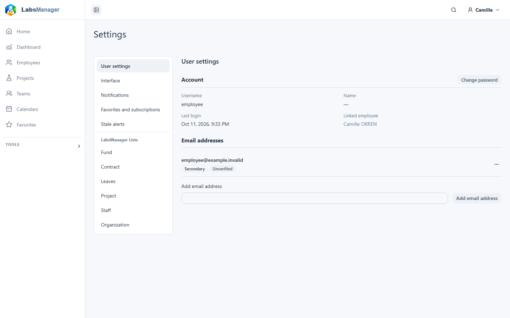
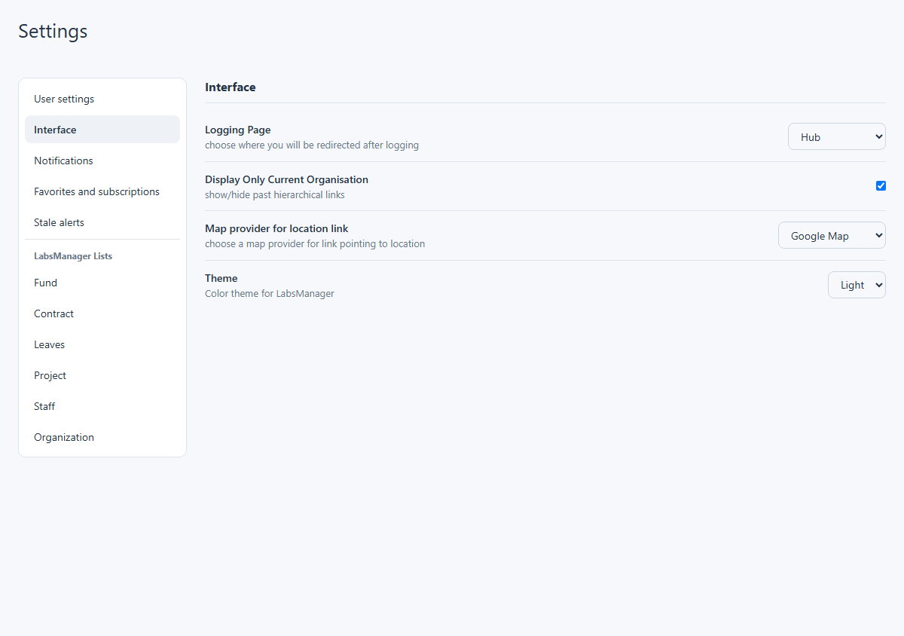
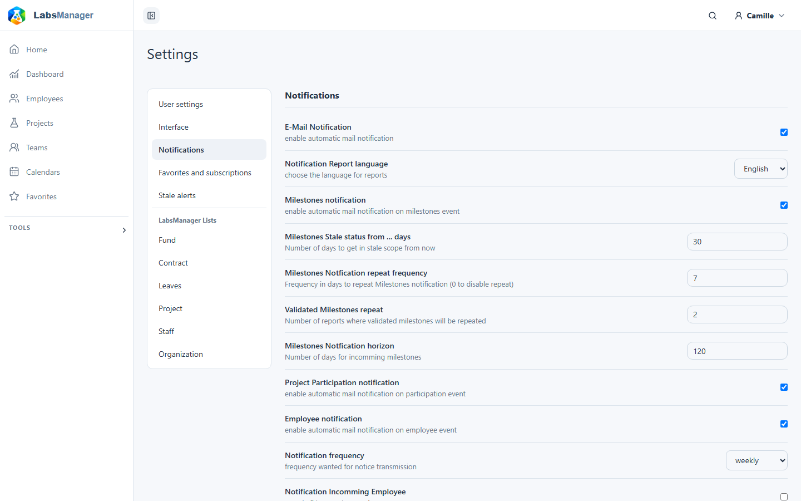

# Manage your settings

Open your account menu at the top right and choose **User settings**. You can also open `/app/settings/user` directly. The personal settings area has five sections: **User settings**, **Interface**, **Notifications**, **Favorites and subscriptions**, and **Stale alerts**. Select a section in the settings navigation. All five are available to signed-in users; the values and saved changes belong to your account.

You may also see **Lists** or **Administration** in the settings navigation. Those areas manage shared reference data or installation-wide settings and are outside these personal preferences. Administration appears only for staff accounts.

## Account and email addresses

The **User settings** section shows your username, name, last login, and linked Employee record when there is one. These details are displayed for reference; this page does not edit them.

Choose **Change password** (or **Set password** if you do not have one) to open a form. Enter your current password when requested, then the new password twice and choose **Save**. Validation errors appear in the form. Depending on your account's sign-in rules, you may be signed out after the change and need to sign in again.

The **Email addresses** list marks each address as primary or secondary and verified or unverified. If **Add email** is available, enter an address and submit the form. An address's action menu may let you make a verified secondary address primary, resend verification, or delete a secondary address. Available actions depend on that address's state and the account rules. Removing an address asks for confirmation; the primary address cannot be removed here.

## Interface

Open **Interface** to choose where you arrive after signing in, whether past organizational links are shown, the map provider for location links, and the application theme. The login destination, map provider and theme use selection lists; the organization option is a switch. The theme choices are **Light** and **Dark**. This section does not change the global calendar's display mode.

Switches and selections save as soon as you change them. The theme applies to the interface when its save succeeds. The page briefly shows saving or saved feedback. If a value is rejected, it shows an error and keeps the previously saved value.

## Notifications

Open **Notifications** to manage automatic email notifications. The section groups these personal controls:

| Area | Controls |
| --- | --- |
| Delivery | Email notification switch; frequency and report language selections. |
| Milestones | Event and subscribed-milestone switches; number fields for stale threshold, repeat interval, report repetition and upcoming horizon. |
| People and projects | Switches for project participation, employee events and incoming employees. |
| Leave | Leave inclusion switch; Calendar/List presentation and time span selections; switch for including employees without leave in the calendar presentation. |

The page shows a description beside each control. Some settings affect which information is included in notification emails; the main email switch controls automatic notification delivery.

The leave presentation choice selects **Calendar** or **List** in the notification email. It does not switch the [global calendar](../calendar/use-the-calendar.md) between Calendar and Resources views. Choose **Send test notification** to request an email, or **Preview notification** to open the rendered message in a new tab. Allow pop-ups if the preview is blocked. These test actions are separate from saving a preference.

Changes to switches and lists save immediately. For a number or text field, leave the field or press Enter to save it. The page shows saving, saved or error feedback. Your installation must be able to deliver email for a test notification to arrive.

## Favorites and subscriptions

The **Favorites and subscriptions** section lists records you have marked or subscribed to. Follow a record link to open it, or choose **Remove** beside an entry to remove that favorite or subscription immediately. An empty list shows an empty state. On supported record pages, the star and bell controls add or remove the same preferences. What you can follow depends on the records available to you.

## Stale alerts and dashboards

The **Stale alerts** section has four non-negative month fields for contracts, projects, milestones and funds. They set the look-ahead horizons used by the corresponding [dashboard summaries](../dashboards/use-your-dashboard.md) for your account. Enter a whole number, then leave the field or press Enter to save. An invalid value is rejected and an error is shown. These are personal dashboard data preferences; widget selection and layout are managed on the [dashboard itself](../dashboards/customize-your-dashboard.md).

There is no separate calendar-view preference in these five sections. Choose the Calendar or Resources mode on the [calendar page](../calendar/use-the-calendar.md) when you use it. The notification email's Calendar/List choice only affects that email's leave presentation.
