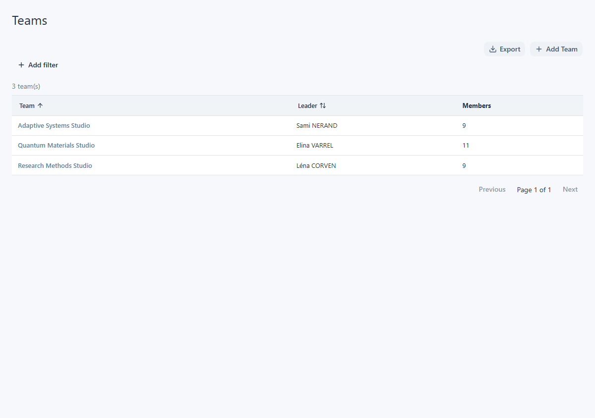
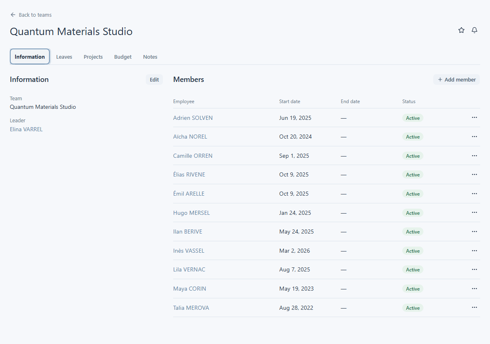

# Trouver et consulter des équipes

Ouvrez **Teams** depuis la navigation principale pour trouver les équipes que vous êtes autorisé à voir. Cette entrée peut être absente si votre compte ne peut pas consulter la liste des équipes. La liste indique le nom, le responsable et le nombre de membres de chaque équipe ; sélectionnez un nom pour ouvrir sa fiche.

## Trouver une équipe

Utilisez les filtres de la liste pour rechercher par **Name**, **Leader** ou **Members**. Vous pouvez trier par nom d’équipe ou par nom de famille du responsable et parcourir les pages de résultats. **Export** est disponible sur la liste. Si vous avez ouvert une équipe depuis une liste filtrée, son lien de retour vous ramène à cette liste.

<figure class="lm-screenshot" markdown>

<figcaption>La liste Teams indique le responsable et le nombre de membres de chaque équipe visible.</figcaption>
</figure>

## Lire la fiche d’une équipe

L’onglet **Information** présente le nom et le responsable de l’équipe, puis ses membres. Chaque ligne de membre indique un statut actif ou inactif ainsi que ses dates de début et de fin, lorsqu’elles sont disponibles. Le nom d’un responsable ou d’un membre ouvre sa fiche collaborateur uniquement si vous avez accès à cette fiche. Pour en savoir plus sur une personne, consultez [Consulter une personne](../people/view-person.md).

<figure class="lm-screenshot" markdown>

<figcaption>L’onglet Information regroupe le responsable, les membres, les dates et les statuts d’appartenance.</figcaption>
</figure>

Les autres onglets présentent **Leaves** dans un calendrier d’équipe, **Projects** avec leurs dates et statuts, les chiffres de **Budget** liés aux projets et les **Notes**. Les informations affichées dépendent de vos droits et des fiches disponibles pour votre équipe. Sélectionnez un projet pour ouvrir sa fiche ; consultez [Consulter un projet](../projects/view-project.md) pour ce parcours. L’onglet **Budget** sert à la consultation ; consultez [Budgets et dépenses](../finance/budgets-and-expenses.md) pour les détails financiers d’un projet.

Si **Add Team**, **Edit** ou des actions sur les membres apparaissent, consultez [Gérer les membres d’une équipe](manage-team-members.md). Leur disponibilité dépend de vos droits sur l’équipe.
