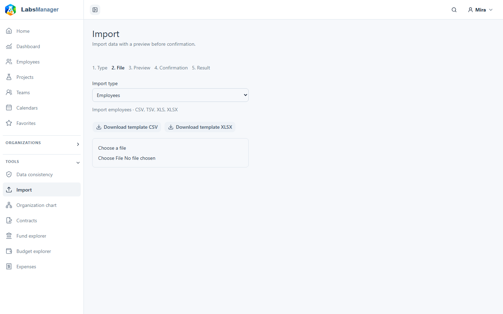
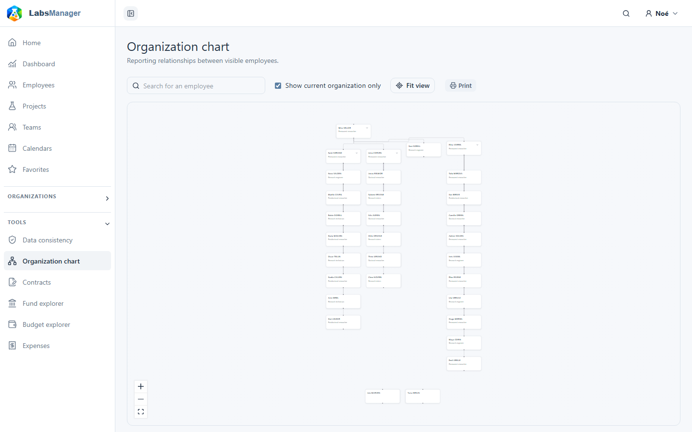
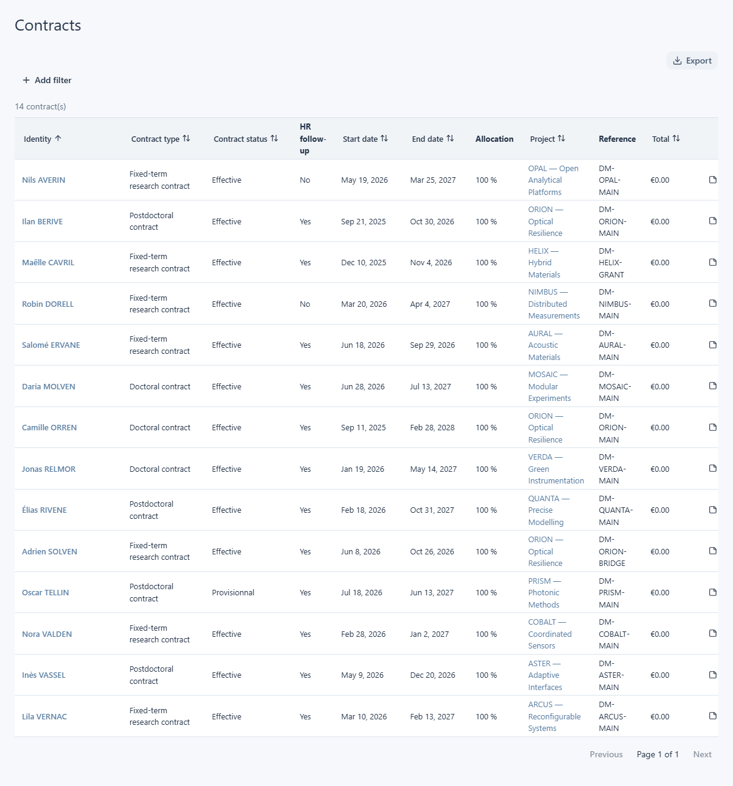

# Utiliser les outils

Ouvrez **Tools** dans la barre latérale pour travailler sur plusieurs fiches. Le menu comprend sept outils React : **Data consistency**, **Import**, **Organization chart**, **Contracts**, **Fund explorer**, **Budget explorer** et **Expenses**. Data consistency et Import n’apparaissent que si votre compte dispose des droits correspondants. D’autres liens peuvent être visibles même lorsqu’une fiche ou une action particulière vous est inaccessible ; les listes et les liens vers les fiches respectent vos droits.

## Cohérence des données

**Tools → Data consistency** présente les problèmes détectés dans les fiches que vous pouvez gérer. Passez des problèmes **Active** aux problèmes **Accepted** ; si plusieurs règles existent, choisissez-en une pour restreindre la liste. Chaque ligne identifie le problème ainsi que le collaborateur, le projet et l’objet concernés. Ouvrez un lien vers un collaborateur ou un projet lorsqu’il est disponible pour examiner la fiche source.

Les actions disponibles dépendent du problème et de vos droits. Elles peuvent permettre d’ajouter un participant manquant, de prolonger la date d’un collaborateur, d’un projet ou d’un financement, d’accepter une exception avec une justification, ou de rouvrir un problème accepté. Vérifiez la modification proposée avant de la confirmer. Si aucun problème ne correspond au statut ou à la règle choisis, la liste affiche un état vide. Cet outil ne comporte pas de commande d’export de liste. Pour les décisions relatives aux corrections et aux exceptions acceptées, consultez [Contrôler la cohérence des données](../../admin/instance-administration/data-consistency.md).

## Import

**Tools → Import** n’apparaît que pour les comptes autorisés à importer des données. Les types disponibles comprennent actuellement **Expenses**, **Employees** et **Expense timepoints** ; l’écran indique les formats de fichier acceptés par type et propose un modèle adapté.

1. Choisissez le type d’import et téléchargez son modèle si utile.
2. Sélectionnez un fichier. S’il comporte plusieurs feuilles, choisissez celle à utiliser. Vérifiez les colonnes reconnues, manquantes et supplémentaires.
3. Sélectionnez **Check** pour prévisualiser l’import. L’aperçu indique les lignes nouvelles, mises à jour, inchangées et erronées, avec leurs détails. Téléchargez le CSV des erreurs s’il est proposé.
4. Sélectionnez **Confirm** seulement après avoir vérifié l’aperçu. Ce bouton n’apparaît que lorsque l’aperçu peut être appliqué ; la confirmation effectue l’import et affiche son résultat.

<figure class="lm-screenshot" markdown>

</figure>

Le choix d’un autre type ou d’une autre feuille efface l’aperçu ultérieur. Un échec de transfert ou de validation affiche une erreur sur la page. La vérification d’un fichier ne confirme pas l’import à elle seule.

## Organigramme

**Tools → Organization chart** affiche la hiérarchie des collaborateurs visibles. Recherchez une personne, puis choisissez un résultat pour centrer sa position. Utilisez **Current only** pour inclure ou exclure les anciens collaborateurs ; ce choix est enregistré pour votre compte. Déployez ou repliez les branches, déplacez ou agrandissez le graphique et utilisez **Fit** pour le recentrer. **Print** ouvre la vue d’impression du graphique. Un nom renvoie à sa [fiche Employee](../people/view-person.md) uniquement si vous pouvez la consulter. Le graphique peut aussi afficher un état vide si aucun collaborateur n’est disponible.

<figure class="lm-screenshot" markdown>

</figure>

## Contrats

**Tools → Contracts** répertorie les contrats associés aux fiches visibles pour vous. Filtrez par état actif, en cours ou ancien, collaborateur, type ou statut du contrat, projet, financeur ou institution. Triez une colonne ou parcourez les pages pour examiner les résultats. Les lignes présentent le collaborateur, le type et le statut du contrat, les dates, ainsi que le contexte du projet et du financement lorsqu’il est disponible. Sélectionnez une ligne pour lire ses détails et les dépenses associées ; suivez les liens Employee ou Project si vos droits le permettent.

<figure class="lm-screenshot" markdown>

</figure>

Selon vos droits, vous pouvez modifier le contrat ou ses notes depuis la ligne sélectionnée. **Export** télécharge la liste filtrée au moyen de la [boîte de dialogue d’export des listes](../reports-and-exports/generate-reports.md). Pour les contrats d’une seule personne, utilisez la [section Contracts de la fiche Employee](../people/work-and-contracts.md). Un résultat vide signifie qu’aucun contrat ne correspond aux filtres et aux droits actuels.

## Explorateur des financements

**Tools → Fund explorer** répertorie les postes de financement des projets visibles, avec la période de financement, le montant, les valeurs consommées et disponibles. Filtrez par projet, financeur, institution, référence, type de coût, participant ou disponibilité ; utilisez au besoin les choix d’activité et de retard. Triez, ouvrez les détails d’une ligne ou les contrats associés lorsque proposés, et exportez la liste filtrée. Le [guide de Fund explorer](../finance/fund-explorer.md) explique cette vue et comprend sa capture. Pour examiner un financement au sein d’un projet, consultez [Consulter un financement](../finance/view-a-fund.md).

## Explorateur des budgets

**Tools → Budget explorer** compare les lignes budgétaires des projets visibles. Filtrez par activité, type de coût, type de contrat ou de collaborateur, collaborateur, projet, institution, financeur, référence de financement ou montant disponible. Triez la liste, sélectionnez une ligne pour consulter ses détails en lecture seule, ou exportez la liste filtrée. Pour travailler dans un seul projet, consultez [Budgets et dépenses](../finance/budgets-and-expenses.md). L’explorateur ne propose pas de formulaire de modification du budget.

## Dépenses

**Tools → Expenses** répertorie les dépenses des projets visibles. Filtrez par type de coût, plage de dates, description, projet, institution, financeur, référence de financement, statut ou référence de dépense. Triez, sélectionnez une ligne pour lire ses détails en lecture seule, ou exportez la liste filtrée. Pour travailler dans un projet ou un financement, consultez [Budgets et dépenses](../finance/budgets-and-expenses.md). L’outil transversal ne propose pas de formulaire de modification d’une dépense.

Les trois outils financiers partagent des commandes de filtrage, de tri, de pagination et d’export de liste. Les lignes et les liens vers les fiches associées dépendent de vos droits ; un filtre peut aussi produire une liste vide.
